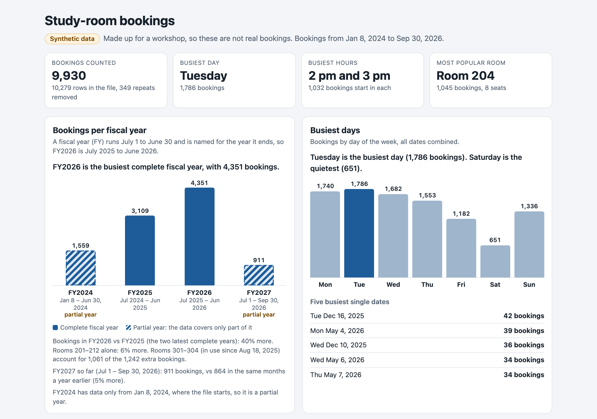

You work at a campus library. Your supervisor wants a one-page dashboard about study-room bookings for the annual
report: how many bookings, when rooms are busiest, and which rooms people want. You have the booking system's
export, and you have Claude Code.

You'll go around the agent loop once: **read → plan → act → check**. Then you'll make the result stick with memory
and a skill, undo a bad change, and share what you built. The data is synthetic.

::: {.callout-note collapse="false"}
## Your finish line

You're done when you have all of these. A fuller list is on the [start page](../index.qmd#what-youll-leave-with),
where you can tick items off.

- `dashboard.html` opens in your browser and reports **fiscal years**
- Its FY2026 total matches the **official count**
- `CLAUDE.md` holds your reporting rule, and Claude follows it after `/clear`
- `/house-style` gives a page the NC State look
- You have a link to share (Pro plan or higher), or a screenshot
:::

::: {.callout-tip}
## Working as a pair?

The **checker** holds two things: the note from your supervisor (step 2) and the official count (step 4). Read the plan
against the note before anyone approves it, and compare the dashboard's number with the official one.
:::

## Before you start

1. Install Claude Code and sign in: see [Set up](../setup.qmd).
2. Download [study-rooms.zip](../downloads/study-rooms.zip) and unzip it to your Desktop. On a Mac, double-click it
   and drag the `study-rooms` folder it makes to your Desktop. On Windows, right-click it, choose **Extract All**, then
   **Extract**, and drag the `study-rooms` folder to your Desktop. The folder holds `README.md` and
   `room_bookings.csv`.
3. Open a terminal, go into the folder, and start Claude Code:

::: {.panel-tabset}
### Mac

::: {.prompt .prompt-shell}
```bash
cd ~/Desktop/study-rooms
claude
```
:::

### Windows

::: {.prompt .prompt-shell}
```powershell
cd $HOME\Desktop\study-rooms
claude
```
:::

If PowerShell says the path doesn't exist, your Desktop is probably in OneDrive: try
`cd $HOME\OneDrive\Desktop\study-rooms`.
:::

Folder not found, on either system? Type `cd` and a space, drag the `study-rooms` folder from Finder or File
Explorer onto the terminal window, and press . Then type `claude`.

4. Claude Code asks for a quick safety check: is this a project you trust? It is: it holds only what you just
   unzipped. Choose **Yes, I trust this folder** (use the arrow keys if it isn't highlighted) and press
   . If Claude Code closes instead, that was **No, exit**: run `claude` again.

::: {.callout-warning}
## Work in this folder only

Claude Code can read and change everything in the folder you start it in. Starting it in your home folder or
Desktop gives it far more reach than this task needs.
:::

## <span class="step-badge">1</span> Read

Ask what's there before asking for anything else.

::: {.prompt}
```default
What's in this folder? Give me a quick summary of the data. Don't change anything yet.
```
:::

::: {.watch}
Claude opens the files itself. A chatbot would have asked you to paste them in. Each step shows as a line: the files it
read, and commands it ran, like `Bash(wc -l room_bookings.csv)`.  shows the details.
:::

Read its summary closely. It may point out problems in the data. **Note what it found**; you'll want it later.

::: {.callout-note collapse="true" appearance="simple"}
## What happened in our rehearsal

Claude read both files with shell tools and reported: 10,279 rows but **9,930 real bookings** (349 rows exported
twice), **213 rows with old room labels like `Rm 204`** instead of `Room 204`, and some blank group sizes. It ended with *"Tell me what you
want built, and whether to fix those three first."*
:::

## <span class="step-badge">2</span> Plan

Your supervisor sent you this note this morning:

::: {.note-card}
<span class="note-from">From your supervisor</span>

Quick reminder for the dashboard: everything we report uses the **fiscal year, July 1 to June 30**, named for the
year it ends. FY2026 = July 1, 2025 to June 30, 2026.
:::

Claude can't see the note, and the prompt below doesn't mention it. That's on purpose. **Predict first:** will
Claude ask you what "year" means, or assume?

Now ask for the dashboard in plan mode, so Claude proposes before it builds:

::: {.prompt}
```default
/plan Build a one-page dashboard, dashboard.html, for my supervisor: total bookings per year, the busiest days and hours, and the most popular rooms. Make it a single file I can open by double-clicking.
```
:::

The mode line at the bottom now reads `⏸ plan mode on`. Claude explores, may ask you a question or two, then shows a
plan and asks how to proceed. **Don't approve it yet.**

- **If it asks which kind of year:** answer from the note. That's the agent doing its job, and you having the answer.
  If it shows choices, use the arrow keys and , or choose the option to type your own answer and
  paste the sentence below.
- **If it doesn't ask:** read the plan. If it counts **calendar years** (2024, 2025, 2026), it made a reasonable
  assumption that's wrong for your office. It couldn't know; the rule isn't in the data.

To fix a wrong assumption before any code exists, choose **No, keep planning**, then type:

::: {.prompt}
```default
We report by fiscal year: July 1 to June 30, named for the year it ends (FY2026 is July 2025 to June 2026). Use fiscal years.
```
:::

When the new plan uses fiscal years, and covers any data problems from step 1 the way you want, choose
**Yes, manually approve edits**.

::: {.watch}
In all four of our rehearsals Claude asked which year to use, but if you just said "go," its default was calendar years
every time. Don't count on being asked. In the default auto mode, Claude is built to keep working rather than stop
for questions, so plan mode is where you get to catch an assumption.
:::

::: {.callout-note collapse="true" appearance="simple"}
## What happened in our rehearsal

Claude asked: *"'Per year': calendar years? Your data stops on Sep 30, 2026, so 2026 has only nine months."* Its
default was **calendar years**, with 2026 marked "Jan–Sep". In four rehearsal runs it asked about the year every time,
and every time its default was calendar years. After the fiscal-year correction, its revised plan hatched the two
partial fiscal years (FY2024 and FY2027) and compared the two complete ones.
:::

## <span class="step-badge">3</span> Act

In manual mode, Claude asks before each change. Approve the first edit or two and look at what it's writing.

Then switch to auto mode and let it finish. The next time Claude asks to run a command, choose **Yes, and switch to
auto mode**. Or press , with no question on screen, until the mode line reads `⏵⏵ auto mode on`
(on Windows, if Shift+Tab does nothing, press ). A separate safety check still reviews each action.
Press  at any point to stop it and redirect.

The build can take 10 to 20 minutes: Claude writes the page, runs its code and checks its own numbers. That's normal.
**Wait for it to finish before you type the next prompt**: anything you type now reaches Claude mid-build.

When it's done, open the dashboard. Ask Claude to open it, or:

::: {.panel-tabset}
### Mac

::: {.prompt}
```default
! open dashboard.html
```
:::

### Windows

::: {.prompt}
```default
! start dashboard.html
```
:::
:::

The `!` runs a command yourself without leaving Claude Code. Double-clicking the file works too.

{.shot fig-alt="A study-room dashboard from a rehearsal run: bookings per year, the busiest days and hours, and the most popular rooms"}

::: {.callout-note collapse="true" appearance="simple"}
## What happened in our rehearsal

Claude wrote the page, then pasted the CSV in with `cat` rather than retyping it, and checked that the copy was
byte-identical. With no browser to look through, it recomputed the key numbers two other ways and said plainly that
it hadn't seen the page. The page worked on the first double-click.
:::

## <span class="step-badge">4</span> Check

A dashboard that looks right isn't the same as one that is right. Your supervisor already knows one number.

::: {.callout-tip collapse="true"}
## The official count

::: {.answer}
<span class="answer-label">Official FY2026 bookings</span><span class="answer-value"></span>
:::

Does your dashboard agree?
:::

Whether it matches or not, make Claude prove it. `/goal` keeps Claude working until a condition holds, and a
separate model checks after every turn:

::: {.prompt}
```default
/goal dashboard.html shows FY2026 = 4,351 bookings, the official count. If it doesn't, explain why before changing anything. Prove the final number by counting the CSV yourself, and don't hard-code it. Stop after 5 turns.
```
:::

::: {.watch}
Why it might not match: the export lists some bookings twice. Did Claude mention that in step 1? Did the plan say
what to do about it? The fix is to count each `booking_id` once.
:::

::: {.callout-note collapse="true" appearance="simple"}
## If your number doesn't match

A wrong number usually points straight at its cause:

| Your dashboard says | What happened |
| --- | --- |
| **4,351** | Fiscal year, each booking counted once ✓ |
| 4,513 | Fiscal year, but 162 bookings counted twice (the duplicate rows) |
| 3,127 | Calendar 2026, January to September only |
| 3,696 | Calendar 2025, the last full calendar year |
| 3,239 or 3,829 | Calendar 2026 or 2025, with the duplicates |
:::

If something on the page looks wrong, show Claude instead of describing it. Take a screenshot to the clipboard
( on a Mac,  on Windows), then paste it into your prompt
with  (Mac Terminal) or  (Windows) and say what's off.

::: {.callout-note collapse="true" appearance="simple"}
## What happened in our rehearsal

The dashboard already said **4,351**. `/goal` made Claude prove it: it confirmed the number wasn't typed into the
page, counted unique `booking_id`s in the fiscal-year date range two separate ways, and showed that counting rows
instead gives 4,513 (162 repeated IDs). The goal was met in one round.
:::

## <span class="step-badge">5</span> Remember

Claude forgets everything when a conversation ends, except what's written down. You'll write your rule in
`CLAUDE.md`, a file Claude reads at the start of every session in this folder.

::: {.prompt}
```default
Add our reporting rules to CLAUDE.md: we use fiscal years (July 1 to June 30, named for the year they end), and each booking_id counts once.
```
:::

Run `/memory` to see it listed, along with **auto memory**: notes Claude saves for itself as it works. `CLAUDE.md`
is what *you* tell it; auto memory is what *it* learns. Press  to close the list; you don't need to
open anything.

Now test it. Type `/clear` to start a fresh conversation, then ask:

::: {.prompt}
```default
Which fiscal year had the most bookings, and how much did it grow over the year before?
```
:::

It should answer in fiscal years without being told again: FY2026, up about 
from FY2025.

::: {.callout-note collapse="true" appearance="simple"}
## What happened in our rehearsal

After `/clear`, a fresh session answered: *"FY2026 had the most bookings: 4,351. That is up 1,242 (+39.9%, about 40%)
from FY2025's 3,109."* It followed both rules in `CLAUDE.md` without being told. Along the way, one of its own shell
commands printed 0 because of a quoting bug. It noticed, explained why, and fixed it.
:::

## <span class="step-badge">6</span> Make a skill

A skill is a reusable set of instructions with a name. You run it as a command, and Claude can also use it on its own
when it fits. (Skills are what Claude Code used to call custom commands.) Have Claude write one:

::: {.prompt}
```default
Create a skill called house-style that gives any web page we make the NC State look: Wolfpack Red #CC0000 for highlights, dark gray text on white, Arial or Helvetica, a red header bar with the page title, and a footer that says "Synthetic data made for a workshop." Use it whenever you create or restyle a web page.
```
:::

Claude writes `.claude/skills/house-style/SKILL.md`. This folder had no skills before, so Claude Code isn't watching
that folder yet. Tell it to look once:

::: {.prompt}
```default
/reload-skills
```
:::

Then run your skill:

::: {.prompt}
```default
/house-style dashboard.html
```
:::

Reload the page in your browser. If Claude Code says **Unknown command: /house-style**, run `/reload-skills` and
try again. Change the skill later? Run `/reload-skills` again.

Now ask for something new, without mentioning the style, and watch whether Claude reaches for the skill on its own:

::: {.prompt}
```default
Make a one-page summary for the library's dean, summary.html, with the three numbers that matter most.
```
:::

::: {.callout-note collapse="true" appearance="simple"}
## What happened in our rehearsal

For the dean's summary, Claude **used the house-style skill without being asked**. It also chose a third number on its
own: **+6%** growth in the original twelve rooms, next to the **+40%** headline, *"because the headline +40% alone
would mislead"*: most of the growth came from the four new rooms. See it on the
[finished examples](../examples.qmd) page.
:::

## <span class="step-badge">7</span> Undo

Everyone makes a change they regret. Make one on purpose:

::: {.prompt}
```default
Make dashboard.html rainbow-colored, with Comic Sans everywhere.
```
:::

Look at it. Then type `/rewind` (or press  twice on an empty prompt), pick **your rainbow
prompt** itself, and choose **Restore code**. Rewind goes back to just before the prompt you pick. Reload: it's back.

::: {.callout-warning}
## What rewind can't undo

`/rewind` restores files Claude edited with its own editing tools. It **doesn't** undo what shell commands did, such
as deleting (`rm`) or moving (`mv`) files. For real work, keep copies or use git.
:::

## <span class="step-badge">8</span> Share

::: {.prompt}
```default
Publish dashboard.html as an artifact.
```
:::

Claude gives you a link to a private page on claude.ai. Open it, choose **Share**, and you can make a public link
anyone can open. This needs a Pro, Max, Team or Enterprise plan. On a Team or Enterprise plan, public links are off
unless your organization turns them on, so share within your organization instead. On a Console account, share a
screenshot.
`/artifacts` lists what you've published.

## Make it yours

You have ten minutes and an agent. Pick one:

- **Improve the dashboard:** a filter by who booked, a dark mode, a button that downloads the numbers.
- **Build something you'd use:** a study timer in NC State colors, a flashcard quiz from your own notes, a
  weekly planner. Start in a new empty folder: `/exit`, then `cd ..`, `mkdir my-project`, `cd my-project`
  and `claude`, the same on Mac and Windows.
- **Try your own data**, as long as it's data you're allowed to share with an AI service.

Give it a finish line Claude can prove from its own work, such as:

::: {.prompt}
```default
/goal every button on the page has code behind it that visibly changes the page, and the page needs no other files. Prove it from the code. Stop after 5 turns.
```
:::

## If something goes wrong

| What happens | Try |
| --- | --- |
| Claude asks a question instead of planning | Answer it. That's the plan step working. |
| The page opens blank | Paste a screenshot and say "this opens blank when I double-click it." |
| Your number doesn't match and you're stuck | Ask: "List every reason the FY2026 count could differ from 4,351, and check each one." |
| A window offers to install "command line developer tools" (Mac) | Claude tried a tool your Mac doesn't have. Choose **Not Now**; it will find another way. |
| Claude has gone in circles twice | `/clear` and ask again, with what you learned in the first prompt. |
| Claude says "You've hit your Opus limit" | Type `/model sonnet` and carry on. |
| You're out of time | Download the [finished example](../downloads/study-rooms-finished.zip) and compare. |

<p class="small-muted">Checked against Claude Code  on .</p>
