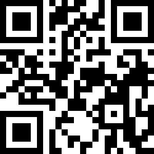

# Habits {.divider background-color="#CC0000"}

[What to keep doing after today]{.eyebrow}

## Seven habits worth keeping

::: {.cards .two style="font-size:1.05em"}
::: {.card}
1. **Plan before anything that matters.** Read it for assumptions you didn't make.
2. **Write down what it can't know** in `CLAUDE.md`.
3. **Give it a way to check its work**: a number you trust, a test, a `/goal`.
4. **Check one number yourself.** Looking right isn't being right.
:::

::: {.card}
5. **Know your undo.** `/rewind` doesn't undo shell commands. Copies, or git.
6. **Mind the data.** Only what you may share with an AI service; follow NC State's rules for sensitive data.
7. **Start fresh between tasks** with `/clear`. Long, tangled sessions get worse.
:::
:::

## Did we make the finish line?

<ul class="finish">
<li>Claude Code installed and signed in on your laptop</li>
<li>A dashboard, built by Claude from a messy spreadsheet</li>
<li>Your plan checked against the boss's note, <b>before</b> any code was written</li>
<li>The dashboard's key number checked against the official answer</li>
<li>A <code>CLAUDE.md</code> that remembers, and a <code>/house-style</code> skill you keep</li>
<li>A link you can share, or a screenshot</li>
<li>Something of your own</li>
</ul>

## Keep going

::: {.two-col style="grid-template-columns:1.4fr 0.6fr"}
::: {style="font-size:0.8em"}
- **On your own:** the ** activity: same eight steps, a different trap
- **On the materials page:** the cheat sheet, the finished examples, these slides
- `/powerup` in Claude Code: short interactive lessons
- **Help** with access or setup: [go.ncsu.edu/getdatahelp](https://go.ncsu.edu/getdatahelp)
- **Questions:** [](mailto:)
:::

::: {style="text-align:center"}
{.qr fig-alt="QR code for the workshop materials page, go.ncsu.edu/dss-claude"}

[go.ncsu.edu/dss-claude]{.muted}
:::
:::

## Thank you {.thank-you-slide}

## Tell us how we did

::: {style="text-align:center"}
[go.ncsu.edu/dss-workshop-eval](https://go.ncsu.edu/dss-workshop-eval){style="font-size:1.5em;font-weight:800"}

{.qr .qr-big fig-alt="QR code for the workshop evaluation, go.ncsu.edu/dss-workshop-eval"}
:::
