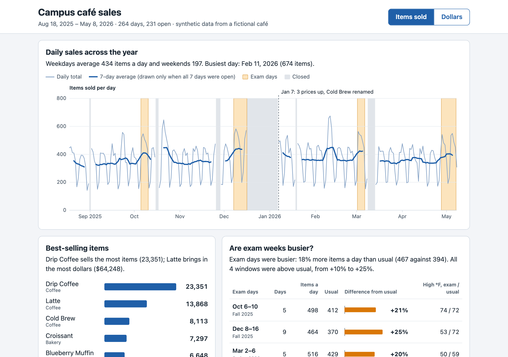
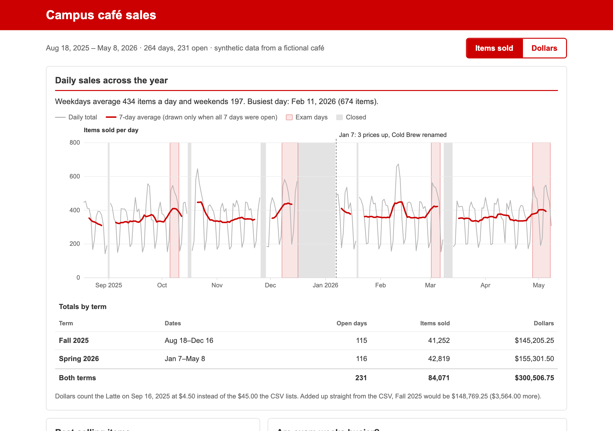
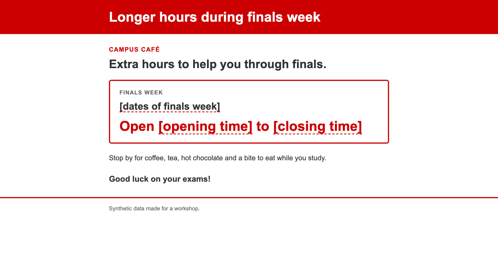





## Get the starter folder

1. Materials page → **cafe.zip** → unzip it to your **Desktop**
2. Go into the folder (never your home folder) and start Claude Code:

::: {.cards .two}
::: {.card}
[Mac]{.card-title}

cd ~/Desktop/cafe claude

:::

::: {.card}
[Windows]{.card-title}

cd $HOME&#92;Desktop&#92;cafe claude

:::
:::

3. Not found? Type `cd` and a space, drag the folder in, press Enter
4. *"Quick safety check"* → **Yes, I trust this folder**



# The loop, for real {.divider background-color="#CC0000"}

[Campus café sales: read → plan → act → check]{.eyebrow}

## The job

::: {.two-col}
::: {}
You help run a campus café. The manager wants a **one-page dashboard**:

- how sales moved over the year
- what sells best
- whether exam weeks really are busier

You have a year of register data, `cafe_sales.csv`, and Claude Code.
:::

::: {.card}
[What's in the folder]{.card-title}

`README.md`: what each column means

`cafe_sales.csv`: one row per menu item per day, August 2025 to May 2026

*Synthetic data, made up for today.*
:::
:::

## 1 · Read

What's in this folder? Give me a quick summary of the data. Don't change anything yet.

- Watch it **open the files itself** and run commands, like `Bash(wc -l cafe_sales.csv)`
- A chatbot would have asked you to paste them in
- Copy every prompt from **Today's activity** on the materials page

[Read its summary. What looks odd in the data?]{.pill .dark}

## 2 · Plan: a note from the manager

From the café managerExam weeks this year were <b>Oct 6–10</b> and <b>Dec 8–16</b> in the fall, and <b>Mar 2–6</b> and <b>Apr 28–May 7</b> in the spring. We were closed over the breaks, so those days show zero sales.

Claude can't see this note, and the prompt won't mention it. **On purpose.**

[Predict: will Claude ask for the exam dates, or work them out some other way?]{.pill .dark}

## 2 · Plan

/plan Build a one-page dashboard, dashboard.html, for the café manager: daily sales across the year, the best-selling items, and whether exam weeks are busier. Make it a single file I can open by double-clicking.

- The mode line says `⏸ plan mode on`: it reads, may ask, then **proposes**
- **It asks for the dates?** Answer from the note.
- **It guesses them from the busiest weeks?** Catch it: that makes "exam weeks are busier" true by definition.
- **Pairs:** the checker reads the plan against the note

## Catch it before any code exists

::: {.two-col}
::: {}
When the plan is ready, you choose:

1. Yes, and use auto mode
2. **Yes, manually approve edits** ← once the plan is right
3. **No, keep planning** ← if it isn't

Exam weeks were Oct 6–10 and Dec 8–16 in the fall, and Mar 2–6 and Apr 28–May 7 in the spring. Use those exact dates, and leave days we were closed out of the averages.

:::

::: {.card}
[In rehearsal]{.card-title}

Claude **asked** for the exam dates every time.

Its fallback, if you just said "go": **finals only**, missing both midterm weeks, or **no exam panel** at all.

The café's two busiest weeks were a **career fair** and **homecoming**, not exams.
:::
:::

## Hands up

- Whose Claude **asked** for the exam dates?
- Whose Claude planned to **guess** them?
- Whose plan already fixed the **$45.00 latte**?

::: {.statement style="margin-top:34px"}
Same prompt, thirty laptops, different behavior. *That's why you read the plan.*
:::

## 3 · Act

::: {.two-col}
::: {}
- Approve the first edit or two. **Read what it writes.**
- Then **Yes, and switch to auto mode**, or <kbd>Shift</kbd>+<kbd>Tab</kbd> until the mode line says `⏵⏵ auto mode on`
  (Windows: <kbd>Alt</kbd>+<kbd>M</kbd>)
- <kbd>Esc</kbd> any time to stop and redirect
- It takes a while. **Don't type the next prompt until it's done**
:::

::: {}
| Mode | Claude… |
|---|---|
| `⏸ manual` | asks before edits and most commands |
| `⏵⏵ accept edits` | edits, plus file commands like `mv` and `rm`; asks before others |
| `⏸ plan` | proposes; changes nothing |
| `⏵⏵ auto` (default) | acts; a safety check reviews each action |
:::
:::



# Check it {.divider background-color="#CC0000"}

[Open the page, then make sure it's right]{.eyebrow}

## Open it

! open dashboard.html

[Windows: `! start dashboard.html`. Or just ask Claude to open it. Still building? Let it finish first.]{.muted}

{.shot height="430" fig-alt="A café dashboard built in a rehearsal run"}

## 4 · Check

A dashboard that **looks** right isn't one that **is** right. The manager knows one number:

Official fall sales, Aug 18 – Dec 16, 2025

[What does yours say? No fall total on your page? Ask Claude for it.]{.pill .dark}

## Make it prove it

/goal The dashboard's fall-semester sales (Aug 18 to Dec 16, 2025) match the café's official $145,205.25. If they don't, explain why before changing anything. Prove the final number from the CSV yourself, and don't hard-code it. Stop after 5 turns.

- Claude keeps working until the condition holds
- A **separate model** checks after every turn
- Give it a finish line it can prove, rules it must keep, and a limit

## What a wrong number tells you

| Your dashboard says | What happened |
|---|---|
| **$145,205.25** | The $45.00 latte corrected to $4.50 ✓ |
| $148,769.25 | The $45.00 latte on Sep 16 counted as rung up: $3,564 too high |
| $144,809.25 | The latte row dropped instead of corrected: $396 too low |

::: {.muted style="margin-top:18px"}
Something on the page looks off, like one day towering over the rest? Screenshot it to the clipboard (Mac
<kbd>⌃</kbd><kbd>⇧</kbd><kbd>⌘</kbd><kbd>4</kbd>, Windows <kbd>Win</kbd><kbd>⇧</kbd><kbd>S</kbd>) and paste it into
Claude (<kbd>Ctrl</kbd>+<kbd>V</kbd>, or <kbd>Alt</kbd>+<kbd>V</kbd> on Windows).
:::

## 5 · Remember

Add what we learned to CLAUDE.md: the exam-week dates, that days with zero sales for every item mean we were closed, and that "Cold Brew Coffee" is the same item as "Cold Brew".

`/memory` to see it → `/clear` for a fresh conversation → then ask:

How much busier were exam weeks than other weeks, per day we were open?

It should use **your** dates and skip closed days, without being told again.



## Before and after

::: {.cards .two}
::: {}
{.shot fig-alt="The dashboard before the house style"}
:::

::: {}
{.shot fig-alt="The dashboard after /house-style"}
:::
:::

## Does Claude reach for it on its own?

Make a flyer for the café, flyer.html, announcing longer hours during finals week.

No mention of the style. Watch for a `Skill(house-style)` line, and look at the result.

{.shot height="320" fig-alt="A flyer for the café's finals-week hours"}

# Undo and share {.divider background-color="#CC0000"}

[Mistakes are cheap, if you know your undo]{.eyebrow}




