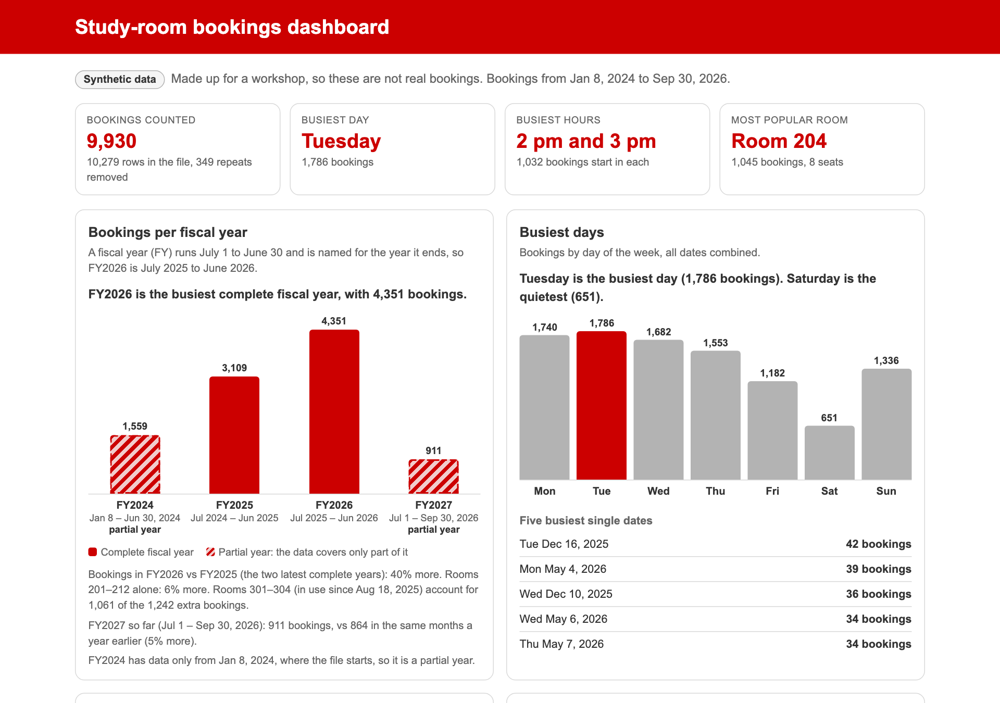
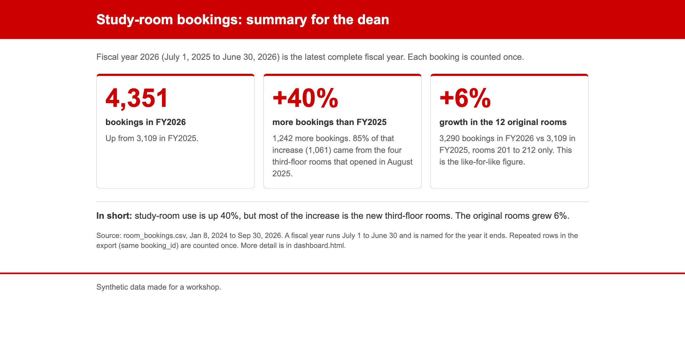





## Get the starter folder

1. Materials page → **study-rooms.zip** → unzip it to your **Desktop**
2. Go into the folder (never your home folder) and start Claude Code:

::: {.cards .two}
::: {.card}
[Mac]{.card-title}

cd ~/Desktop/study-rooms claude

:::

::: {.card}
[Windows]{.card-title}

cd $HOME&#92;Desktop&#92;study-rooms claude

:::
:::

3. Not found? Type `cd` and a space, drag the folder in, press Enter
4. *"Quick safety check"* → **Yes, I trust this folder**



# The loop, for real {.divider background-color="#CC0000"}

[Study-room bookings: read → plan → act → check]{.eyebrow}

## The job

::: {.two-col}
::: {}
You work at a campus library. Your supervisor wants a **one-page dashboard** for the annual report:

- how many bookings, per year
- when rooms are busiest
- which rooms people want

You have the booking system's export, `room_bookings.csv`, and Claude Code.
:::

::: {.card}
[What's in the folder]{.card-title}

`README.md`: what each column means

`room_bookings.csv`: 10,279 rows, January 2024 to September 2026

*Synthetic data, made up for today.*
:::
:::

## 1 · Read

What's in this folder? Give me a quick summary of the data. Don't change anything yet.

- Watch it **open the files itself** and run commands, like `Bash(wc -l room_bookings.csv)`
- A chatbot would have asked you to paste them in
- Copy every prompt from **Today's activity** on the materials page

[Read its summary. What problems did it find?]{.pill .dark}

## 2 · Plan: a note from your supervisor

From your supervisorQuick reminder for the dashboard: everything we report uses the <b>fiscal year, July 1 to June 30</b>, named for the year it ends. FY2026 = July 1, 2025 to June 30, 2026.

Claude can't see this note, and the prompt won't mention it. **On purpose.**

[Predict: will Claude ask what "year" means, or assume?]{.pill .dark}

## 2 · Plan

/plan Build a one-page dashboard, dashboard.html, for my supervisor: total bookings per year, the busiest days and hours, and the most popular rooms. Make it a single file I can open by double-clicking.

- The mode line says `⏸ plan mode on`: it reads, may ask, then **proposes**
- **It asks which year?** Answer from the note.
- **It doesn't ask?** Look for 2024, 2025, 2026: calendar years.
- **Pairs:** the checker reads the plan against the note

## Catch it before any code exists

::: {.two-col}
::: {}
When the plan is ready, you choose:

1. Yes, and use auto mode
2. **Yes, manually approve edits** ← once the plan is right
3. **No, keep planning** ← if it isn't

We report by fiscal year: July 1 to June 30, named for the year it ends (FY2026 is July 2025 to June 2026). Use fiscal years.

:::

::: {.card}
[In rehearsal]{.card-title}

Claude **asked** which kind of year in 4 of 4 runs.

Its default, if you just said "go": **calendar years, every time.**

Asking is good. Counting on it isn't.
:::
:::

## Hands up

- Whose Claude **asked** which year to use?
- Whose Claude **assumed** calendar years?
- Whose plan already dealt with the **duplicate rows**?

::: {.statement style="margin-top:34px"}
Same prompt, thirty laptops, different behavior. *That's why you read the plan.*
:::

## 3 · Act

::: {.two-col}
::: {}
- Approve the first edit or two. **Read what it writes.**
- Then **Yes, and switch to auto mode**, or <kbd>Shift</kbd>+<kbd>Tab</kbd> until the mode line says `⏵⏵ auto mode on`
  (Windows: <kbd>Alt</kbd>+<kbd>M</kbd>)
- <kbd>Esc</kbd> any time to stop and redirect
- It takes a while. **Don't type the next prompt until it's done**
:::

::: {}
| Mode | Claude… |
|---|---|
| `⏸ manual` | asks before edits and most commands |
| `⏵⏵ accept edits` | edits, plus file commands like `mv` and `rm`; asks before others |
| `⏸ plan` | proposes; changes nothing |
| `⏵⏵ auto` (default) | acts; a safety check reviews each action |
:::
:::



# Check it {.divider background-color="#CC0000"}

[Open the page, then make sure it's right]{.eyebrow}

## Open it

! open dashboard.html

[Windows: `! start dashboard.html`. Or just ask Claude to open it. Still building? Let it finish first.]{.muted}

{.shot height="430" fig-alt="A study-room dashboard built in a rehearsal run"}

## 4 · Check

A dashboard that **looks** right isn't one that **is** right. Your supervisor knows one number:

Official FY2026 bookings

[What does yours say?]{.pill .dark}

## Make it prove it

/goal dashboard.html shows FY2026 = 4,351 bookings, the official count. If it doesn't, explain why before changing anything. Prove the final number by counting the CSV yourself, and don't hard-code it. Stop after 5 turns.

- Claude keeps working until the condition holds
- A **separate model** checks after every turn
- Give it a finish line it can prove, rules it must keep, and a limit

## What a wrong number tells you

| Your dashboard says | What happened |
|---|---|
| **4,351** | Fiscal year, each booking counted once ✓ |
| 4,513 | Fiscal year, but 162 bookings counted twice (the duplicate rows) |
| 3,127 | Calendar 2026, January to September only: the plan's default |
| 3,696 | Calendar 2025, the last full calendar year |
| 3,239 or 3,829 | Calendar 2026 or 2025, with the duplicates |

::: {.muted style="margin-top:18px"}
Something on the page looks off? Screenshot it to the clipboard (Mac <kbd>⌃</kbd><kbd>⇧</kbd><kbd>⌘</kbd><kbd>4</kbd>,
Windows <kbd>Win</kbd><kbd>⇧</kbd><kbd>S</kbd>) and paste it into Claude (<kbd>Ctrl</kbd>+<kbd>V</kbd>, or
<kbd>Alt</kbd>+<kbd>V</kbd> on Windows).
:::

## 5 · Remember

Add our reporting rules to CLAUDE.md: we use fiscal years (July 1 to June 30, named for the year they end), and each booking_id counts once.

`/memory` to see it → `/clear` for a fresh conversation → then ask:

Which fiscal year had the most bookings, and how much did it grow over the year before?

It should say **FY2026, up about **, without being told the rule again.



## Before and after

::: {.cards .two}
::: {}
{.shot fig-alt="The dashboard before the house style"}
:::

::: {}
{.shot fig-alt="The dashboard after /house-style"}
:::
:::

## Does Claude reach for it on its own?

Make a one-page summary for the library's dean, summary.html, with the three numbers that matter most.

No mention of the style. Watch for a `Skill(house-style)` line, and look at the result.

{.shot height="320" fig-alt="A one-page summary for the dean"}

# Undo and share {.divider background-color="#CC0000"}

[Mistakes are cheap, if you know your undo]{.eyebrow}




